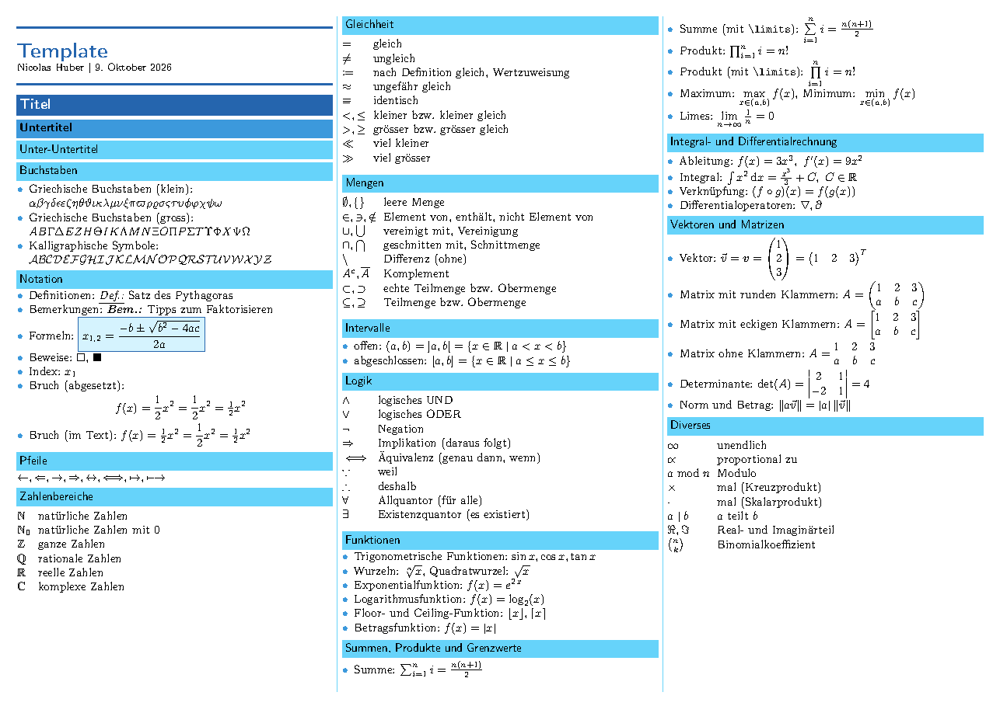

<div align="center">

# cheatsheet-template

**A LaTeX template for compact three-column cheat sheets on landscape A4**


[](https://github.com/HuberNicolas/cheatsheet-template/actions/workflows/build.yml)


[Preview](#preview) · [Quick start](#quick-start) · [Usage](#usage) · [PDF](https://github.com/HuberNicolas/cheatsheet-template/releases/latest)

</div>

## Features

- 📐 Three columns on landscape A4 with 0.5 cm margins; the number of columns is an option
- 🎨 Color-coded heading boxes for sections, subsections and subsubsections
- 🧮 Math macros for boxed formulas, matrices, norms, absolute values, floor and ceiling
- 📋 A `symbols` table that fills the column width, for symbol–meaning lists
- ⚙️ Compiles with pdfLaTeX (recommended) and LuaLaTeX, locally or on Overleaf
- 🤖 GitHub Actions builds the PDF on every push and attaches it to releases

> [!NOTE]
> Created in 2020 on Overleaf and updated in 2026 (v2): the layout moved into `cheatsheet.sty`, the heading boxes
> fit the column width, lists and tables are compact, and the deprecated `commath` package is replaced by `mathtools`.
> The example content is a German summary of common math notation.

## Contents

- [Preview](#preview)
- [Repository structure](#repository-structure)
- [Quick start](#quick-start)
- [Usage](#usage)
- [Customisation](#customisation)
- [Build in CI](#build-in-ci)
- [License](#license)
- [Author](#author)

## Preview

[](https://github.com/HuberNicolas/cheatsheet-template/releases/latest)

## Repository structure

| Path | Content |
|---|---|
| [`cheatsheet.sty`](cheatsheet.sty) | Layout, colors, heading boxes and math macros |
| [`cheatsheet.tex`](cheatsheet.tex) | Example cheat sheet (math notation, in German) |
| [`.latexmkrc`](.latexmkrc) | latexmk settings (pdfLaTeX, `cheatsheet.tex` as default file) |
| [`.github/workflows/build.yml`](.github/workflows/build.yml) | Builds the PDF and attaches it to releases |
| [`docs/preview.png`](docs/preview.png) | Rendered example, shown above |

## Quick start

### Overleaf

1. Download `cheatsheet.sty` and `cheatsheet.tex` (or the repository as ZIP).
2. In [Overleaf](https://www.overleaf.com/), choose **New Project → Upload Project** and upload both files (or the ZIP).
3. Keep the compiler at **pdfLaTeX** and edit `cheatsheet.tex`.

### Local

You need a TeX distribution with `latexmk`, e.g. [TeX Live](https://tug.org/texlive/) or
[MacTeX](https://tug.org/mactex/). A full installation contains every package the template uses.

1. Clone the repository:

   ```bash
   git clone git@github.com:HuberNicolas/cheatsheet-template.git
   ```

2. Build the PDF (`.latexmkrc` selects pdfLaTeX and `cheatsheet.tex`):

   ```bash
   latexmk
   ```

3. Rebuild on every save while you edit:

   ```bash
   latexmk -pvc
   ```

4. Remove the build files:

   ```bash
   latexmk -c
   ```

### Docker

Without a local TeX installation, build with the official TeX Live image (several GB):

```bash
docker run --rm -v "$PWD":/w -w /w texlive/texlive:latest latexmk
```

## Usage

A minimal cheat sheet:

```latex
\documentclass[fontsize=10pt]{scrartcl}
\usepackage[columns=3]{cheatsheet}
\usepackage[english]{babel}

\title{Linear Algebra}
\author{Your Name}
\date{\today}

\begin{document}
\begin{cheatsheet}
\maketitle

\section{Matrices}
\subsection{Determinant}
\eqbox{\det\matp{a & b \\ c & d} = ad - bc}

\subsubsection{Symbols}
\begin{symbols}
    A^T    & transpose \\
    A^{-1} & inverse \\
\end{symbols}

\end{cheatsheet}
\end{document}
```

| Command / environment | Result |
|---|---|
| `\begin{cheatsheet} … \end{cheatsheet}` | Multi-column body; columns are filled one after another |
| `\maketitle` | Compact title banner at the top of the first column |
| `\section`, `\subsection`, `\subsubsection` | Heading boxes in three shades of blue, unnumbered |
| `\begin{symbols} … \end{symbols}` | Two-column table: symbol (math mode) and meaning (text) |
| `\eqbox{…}` | Formula in a colored box (display style) |
| `\matp{…}`, `\matb{…}`, `\mat{…}` | Matrix with round, square or no brackets |
| `\abs{x}`, `\norm{x}`, `\floor{x}`, `\ceil{x}` | Paired delimiters; the starred form (`\abs*{…}`) scales |
| `\vect{v}` | Bold vector |
| `\dif` | Upright d for integrals: `\int f(x) \dif x` |
| `\defn`, `\bem` | Markers for definitions and remarks (*Def.:*, *Bem.:*) |

## Customisation

| What | Where |
|---|---|
| Number of columns | Package option: `\usepackage[columns=4]{cheatsheet}` |
| Font size | Class option: `\documentclass[fontsize=9pt]{scrartcl}` |
| Colors | `\definecolor{cs-…}` lines in [`cheatsheet.sty`](cheatsheet.sty), or redefine them after loading the package |
| Margins, paper | `geometry` line in [`cheatsheet.sty`](cheatsheet.sty) |
| Heading spacing | `\RedeclareSectionCommand` lines in [`cheatsheet.sty`](cheatsheet.sty) |
| Language | `babel` option in your `.tex` file (`ngerman`, `english`, …) |

## Build in CI

[`build.yml`](.github/workflows/build.yml) compiles `cheatsheet.tex` with
[xu-cheng/latex-action](https://github.com/xu-cheng/latex-action) on every push and pull request and uploads the PDF
as a workflow artifact. Pushing a tag `v*` also attaches the PDF to a GitHub release.

## License

[MIT](LICENSE) © 2020 Nicolas Huber.

## Author

**Nicolas Huber** · [GitHub](https://github.com/HuberNicolas)
